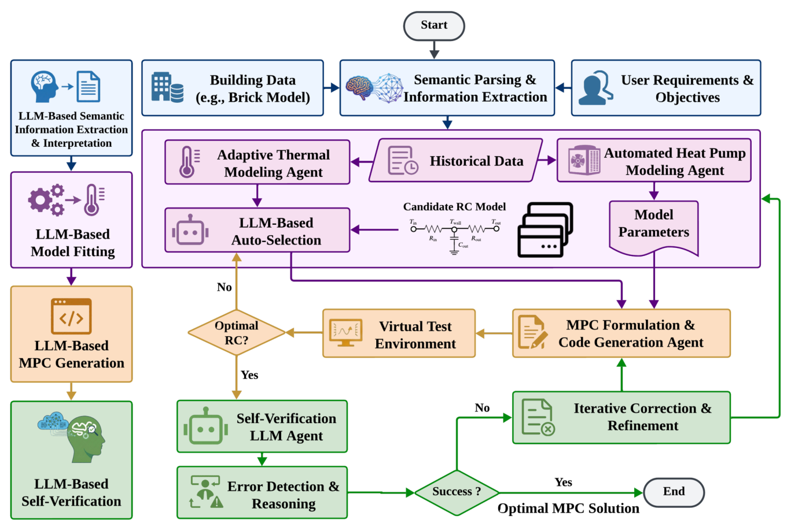
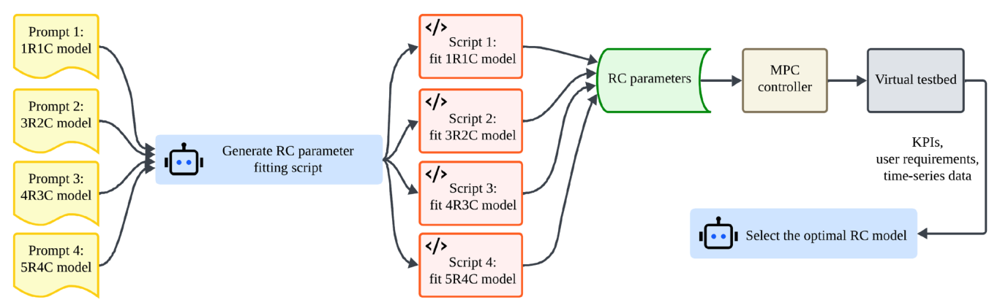
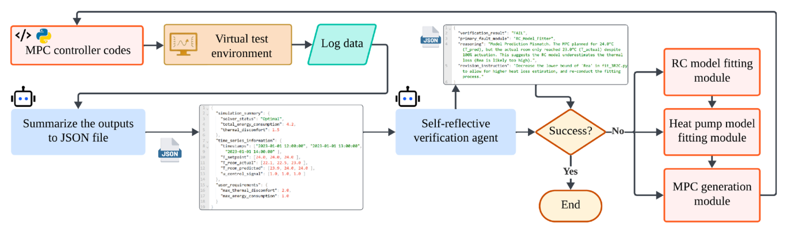
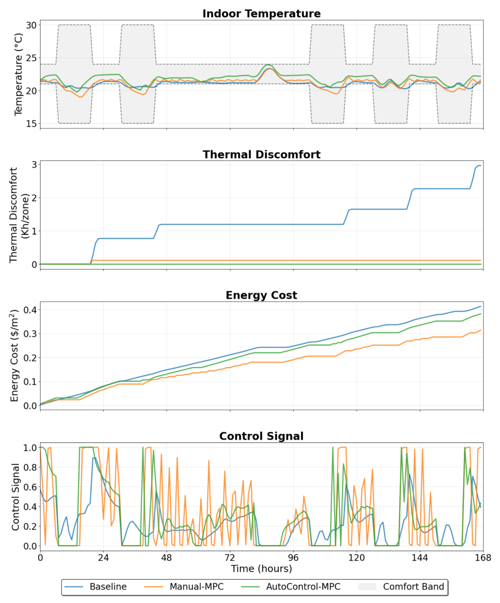
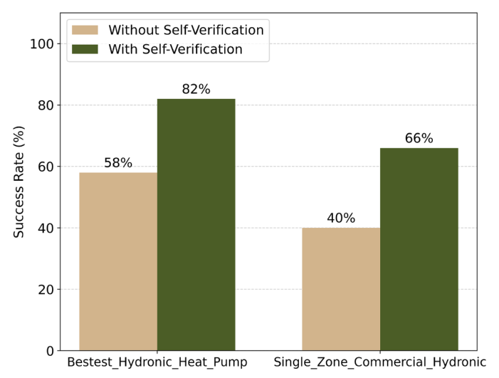

[Paper (Energy and Buildings, 2026)](https://doi.org/10.1016/j.enbuild.2026.118025)

## 📌 Overview

HVAC systems account for a large share of global energy use. Model Predictive Control (MPC) handles their dynamics and uncertainty well, but building an MPC controller is labor-intensive and needs specialist knowledge. Each building needs its own model identification and code, which limits MPC adoption at scale.

**AutoControl-MPC** automates every stage of MPC development with large language models (LLMs). It extends our earlier [AutoControl](/portfolio/autocontrol/) workflow from rule-based control design to model predictive control.

_Overview of the AutoControl-MPC workflow: semantic information extraction, LLM-based model fitting, MPC generation and self-verification._

## 🚀 Key Contributions

- **End-to-end automation:** Each step of MPC development, from understanding the system to generating controller code, runs without manual intervention.
- **Template-driven pipeline:** LLMs follow deterministic decision rules to parse semantic building information (e.g., Brick models), identify system models and generate control code.
- **Automatic RC model selection:** The LLM generates fitting scripts for candidate RC models (1R1C to 5R4C), tests each one in closed loop and picks the best model from KPIs and user requirements.
- **Self-reflective verification:** An LLM agent reads the simulation logs, locates the faulty module and sends revision instructions back to it until the controller passes.

_LLM-based auto-selection of the RC thermal model._

_Self-reflective verification: simulation outputs are summarized to JSON, checked by the verification agent, and errors are routed back to the responsible module._

## 📊 Results

The framework was evaluated on two BOPTest virtual test cases: a residential building with a hydronic heat pump (BESTEST_hydronic_heat_pump) and a single-zone commercial building with a hydronic system.

| Test case | Controller | Thermal discomfort (Kh/zone) | Energy cost ($/m²) |
|---|---|---|---|
| Hydronic heat pump | Baseline | 2.96 | 0.41 |
| | Manual-MPC | 0.11 | 0.31 |
| | **AutoControl-MPC** | **0.00** | 0.38 |
| Commercial hydronic | Baseline | 0.12 | 0.14 |
| | Manual-MPC | 0.16 | 0.13 |
| | **AutoControl-MPC** | **0.11** | **0.13** |

_Control results in the BESTEST_hydronic_heat_pump case: indoor temperature, thermal discomfort, energy cost and control signal._

Self-verification raised the success rate of generating a working controller from 58% to 82% in the heat pump case, and from 40% to 66% in the commercial case.

_Success rate with and without self-verification._

AutoControl-MPC achieves control performance comparable to, and in some cases better than, an expert-developed MPC controller. The results show that LLMs can automate control development for complex building energy systems.

_Figures reproduced from Hu et al., Energy and Buildings, 2026._
