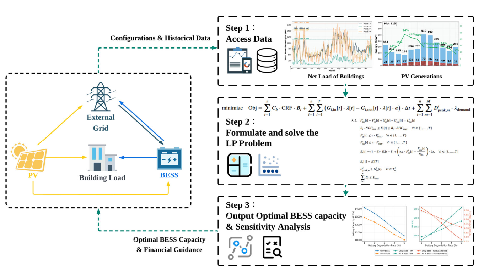
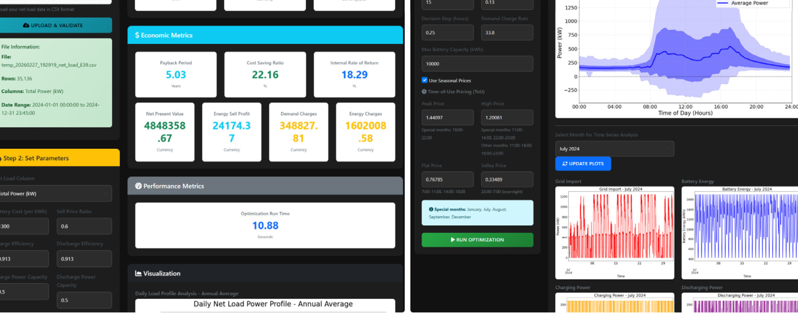

[Paper (Building Simulation, 2026)](https://doi.org/10.1007/s12273-026-1477-1) · [Code on GitHub](https://github.com/huziqi/BCS-Tool)

## 📌 Overview

Distributed battery energy storage systems (BESS) help reduce utility costs and absorb renewable generation that cannot be controlled. Choosing the right BESS capacity is still hard, especially for large industrial parks with distributed PV. Existing methods usually rely on Mixed-Integer Linear Programming (MILP) and nonlinear battery economic models, which are slow to solve and complicate financial evaluation.

**BCS-Tool** is an open-source web application built on a Linear Programming (LP) framework. It sizes BESS for multiple sub-plots at once and reports the financial indicators needed for investment decisions.

_Overview of the BESS optimal sizing framework: access data, formulate and solve the LP problem, then output the optimal capacity and sensitivity analysis._

## 🚀 Key Contributions

- **Linear life-cycle cost model:** Battery self-degradation is embedded directly into the Capital Recovery Factor (CRF), so the economic assessment stays accurate without nonlinear degradation models.
- **Fast LP formulation:** The LP framework reaches the same optimal solution as MILP with more than a thirteen-fold speedup.
- **Off-the-shelf software:** Users upload net-load data as CSV, set battery, tariff and financial parameters, and get the optimal capacity, NPV, IRR and payback period with interactive charts.

## 🖥️ Software Interface

_The BCS-Tool web interface: parameter settings, economic metrics and time-series visualization._

## 📊 Case Study

The tool was tested on a real industrial park in Changsha, China:

- Under a one-part tariff, the optimal capacity is **16.3 MWh**, driven mainly by time-of-use arbitrage. Under a two-part tariff it drops to **11.3 MWh** as the strategy shifts toward peak shaving.
- The LP framework identifies the profitability bound of BESS more accurately than a rule-based control strategy.
- Deploying BESS together with PV gives a payback period of **4.56 years**.

_Figures reproduced from the open-access article under [CC BY 4.0](http://creativecommons.org/licenses/by/4.0/)._
